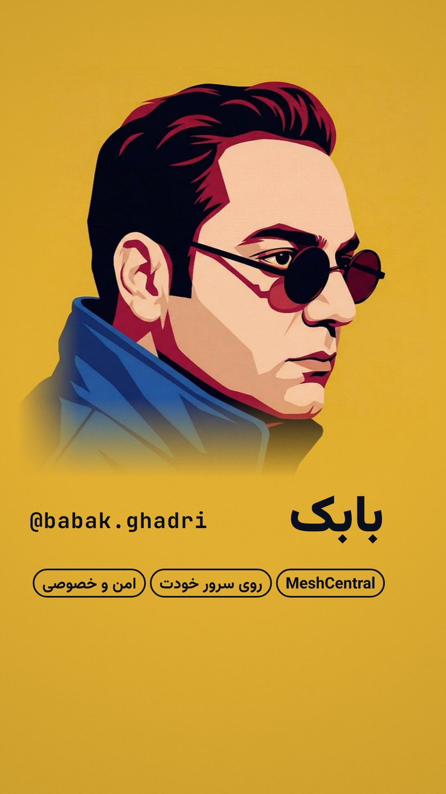

# MeshCentral — @babak.ghadri (Instagram Reel)

A 65-second 9:16 reel for the Instagram page **@babak.ghadri**, cut to Babak's own Persian narration
about MeshCentral. Every frame is code: a canvas film with three.js 3-D sets, rendered frame-exact at
1080×1920 / 60 fps, with a score written for the narration.



**Watch:** [`meshcentral-reel.mp4`](meshcentral-reel.mp4) (65.4 s · 1080×1920 · 60 fps · AAC stereo · −14 LUFS)

> ریلز ۶۵ ثانیه‌ای ۹:۱۶ برای پیج **babak.ghadri**، روی صدای خودت دربارهٔ مش‌سنترال. همهٔ تصویرها با کد
> ساخته شده (three.js برای بخش‌های سه‌بعدی) و صفحه‌های مش‌سنترال واقعی‌اند (از یک سرور مش‌سنترال واقعی گرفته شده).
> فایل نهایی: `meshcentral-reel.mp4`

## The cut

124.8 BPM, 136 beats. The tempo was chosen so the drop lands exactly on the word «مش‌سنترال» (25.0 s);
the narration itself is untouched, only placed 0.25 s in. Full words and timings: [`reel/docs/script.md`](reel/docs/script.md).

| Time | Shot | What it shows |
|---|---|---|
| 0.0 | The code | A nine-digit remote-access ID in extruded 3-D digits that never stops flipping, under «هنوز… منتظری کد AnyDesk بفرستن؟» |
| 5.8 | «یا بدتر؟» | The music stops dead; the line stamps, then the camera pushes through its question mark |
| 6.7 | Outage | A 3-D office of 24 monitors with links out to the world. The links, the «قطع و وصل» line and the music all drop out on the same seeded pattern; on «فلج» the screens die |
| 12.0 | Foreign relay | The camera flies out along one long link, over a border, to a relay rack abroad, then holds behind it: the rack towers, the office is a speck |
| 21.2 | The turn | Lights out, «اما یه راه‌حل خیلی حرفه‌ای‌تر…», a riser |
| 25.0 | **The drop** | "MeshCentral" slams in, silver on MeshCentral's own blue, with its real icon |
| 26.9 | Own server | Back in the same office: the foreign link is gone, a server drops into the middle, the monitors form a ring around it; «متن‌باز / کاملاً خصوصی / روی سرور خودت» |
| 34.4 | Just a browser | The real MeshCentral web UI in a browser card, then the real mobile UI on a phone, walking through every device |
| 42.1 | Behind the scenes | The camera orbits from an employee's monitor to the admin side behind it: a terminal restarting a stopped print spooler, a file browser; «مشکل، درجا حل.» ✓ |
| 50.0 | No limits | «تحریم», «لایسنس», «قطعی» each struck through on its word |
| 53.7 | Secure | A dome of hex tiles closes over the office |
| 57.4 | Babak | The yellow floods up carrying the portrait; «من بابک هستم.», the send-this-post line, a paper plane |
| 63.5 | End card | Portrait, «بابک», `@babak.ghadri`, three tags in his words |

## Real product, not mock-ups

The MeshCentral screens are screenshots of a real MeshCentral 1.2.5 server (installed from npm and run
locally), with demo device groups ("Head Office", "Branch - Karaj") and device entries added through
`meshctrl`. Nothing in its UI was drawn by hand. The logo and icon come from the MeshCentral repository.
The terminal and file panels in the "behind the scenes" shot are graphics, not MeshCentral screens.

## Files

- `reel/film.js`: the film, a pure function of time (`window.seek(t)`), timed in beats.
- `reel/sets/*.js`: the three.js sets (`code`, `world`, `mark`, `screens`, `backstage`).
- `reel/lib/type.js`: Persian kinetic type (right-to-left words rising out of masks on their spoken time).
- `reel/audio/score.py`: the score, the placed narration and the beat grid (`reel/beats.json`).
- `reel/audio/vo/meshcentral.mp3`: the narration as supplied.
- `reel/docs/`: script with timings, shot list, critique log.
- `reel/assets/`: portrait, MeshCentral screenshots and brand art.

Fonts: Vazirmatn (display, Persian + Latin) and JetBrains Mono (labels), both SIL Open Font License (`reel/fonts/`).

## Re-render

The film is rendered with the `motion-reel` skill's scripts (`render.mjs`, `sfx.mjs`, `mix.mjs`):

```sh
cd meshcentral-reel
npm install
MOTION_REEL_SKILL=<skill> uv run reel/audio/score.py                         # music.wav, vo.wav, beats.json
node <skill>/scripts/render.mjs --film reel --format 9x16 --video-only       # picture
node <skill>/scripts/render.mjs --film reel --format 9x16 --hits && node <skill>/scripts/sfx.mjs reel
node <skill>/scripts/mix.mjs reel                                            # -14 LUFS master + mux
```

To preview in a browser, serve this folder and open `reel/index.html?format=9x16` (space plays, arrows step).
